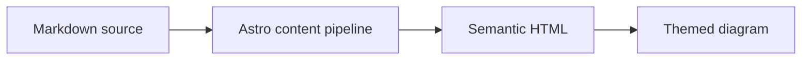

## GitHub 仓库卡片
您可以添加链接到 GitHub 仓库的动态卡片，页面加载时，仓库信息会从 GitHub API 获取。

::github{repo="Fabrizz/MMM-OnSpotify"}

使用代码 `::github{repo="<owner>/<repo>"}` 创建 GitHub 仓库卡片。

```markdown
::github{repo="saicaca/fuwari"}
```

## Mermaid 图表

围栏 `mermaid` 代码块会渲染为图表，并跟随当前配色方案。



## 提示块

支持以下类型的提示块：`note`、`tip`、`important`、`warning`、`caution`

:::note
突出显示用户即使略读也应注意的信息。
:::

:::tip
提供可选信息，帮助用户更顺利地使用。
:::

:::important
用户成功所必需的关键信息。
:::

:::warning
因潜在风险而需要用户立即关注的严重内容。
:::

:::caution
某个操作可能带来的负面后果。
:::

### 基本语法

```markdown
:::note
突出显示用户即使略读也应注意的信息。
:::

:::tip
提供可选信息，帮助用户更顺利地使用。
:::
```

### 自定义标题

提示块的标题可以自定义。

:::note[我的自定义标题]
这是一个带有自定义标题的笔记。
:::

```markdown
:::note[MY CUSTOM TITLE]
This is a note with a custom title.
:::
```

### GitHub 语法

> [!TIP]
> [GitHub 语法](https://github.com/orgs/community/discussions/16925) 同样受支持。

```
> [!NOTE]
> The GitHub syntax is also supported.

> [!TIP]
> The GitHub syntax is also supported.
```

### 剧透

您可以在文本中添加剧透内容。该内容也支持 **Markdown** 语法。

内容 :spoiler[是隐藏的 **哎哟**]！

```markdown
The content :spoiler[is hidden **ayyy**]!

```

## 图片宽度与标题

独立图片可以在其替代文本中接受可选的 `w-N%` 宽度标记，并将 Markdown 标题渲染为图片下方居中的说明文字：


```markdown

```

有效宽度范围从 `w-1%` 到 `w-100%`；无效标记会保留在替代文本中。宽度和说明文字是独立的——仅提供标题也会生成说明文字：


