Mermaid 能将 Markdown 中的文本描述转换为图表。以下示例使用 Shirone 的内容工作流，演示技术文章和项目笔记中常用的图表类型。

## 流程图

流程图描述一个过程，包括决策以及返回先前步骤的路径。

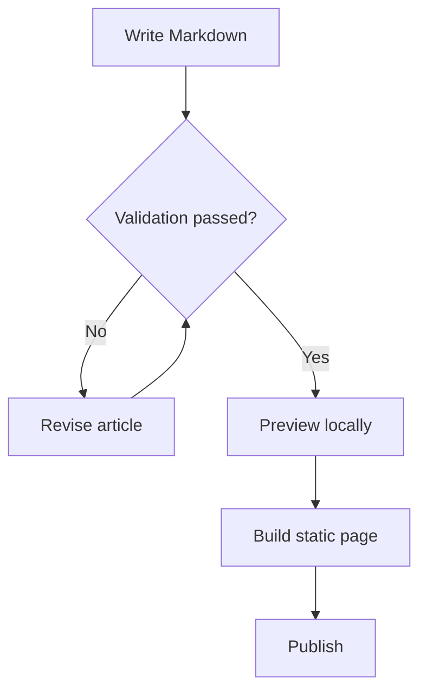

## 时序图

时序图按时间顺序呈现参与者之间的协作。此示例跟踪一次从请求到 Mermaid 渲染的 Swup 导航过程。

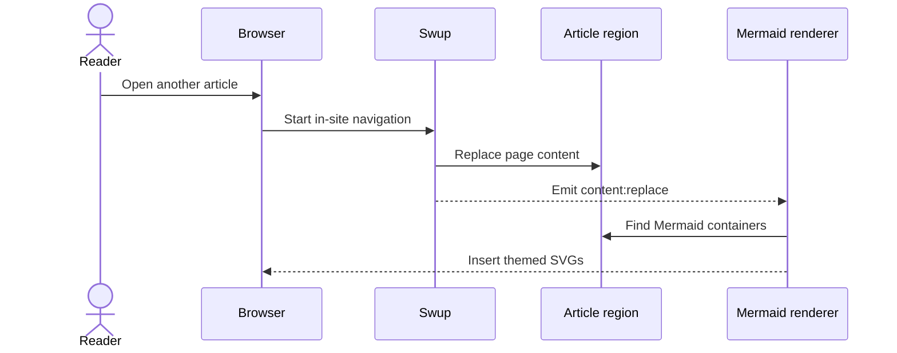

## 实体关系图

实体关系图对结构化数据以及作者、文章、标签和评论之间的连接进行建模。

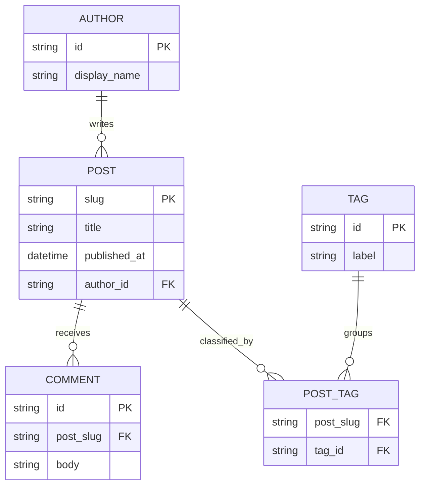

## 类图

类图传达软件设计中的职责、公共方法和依赖方向。

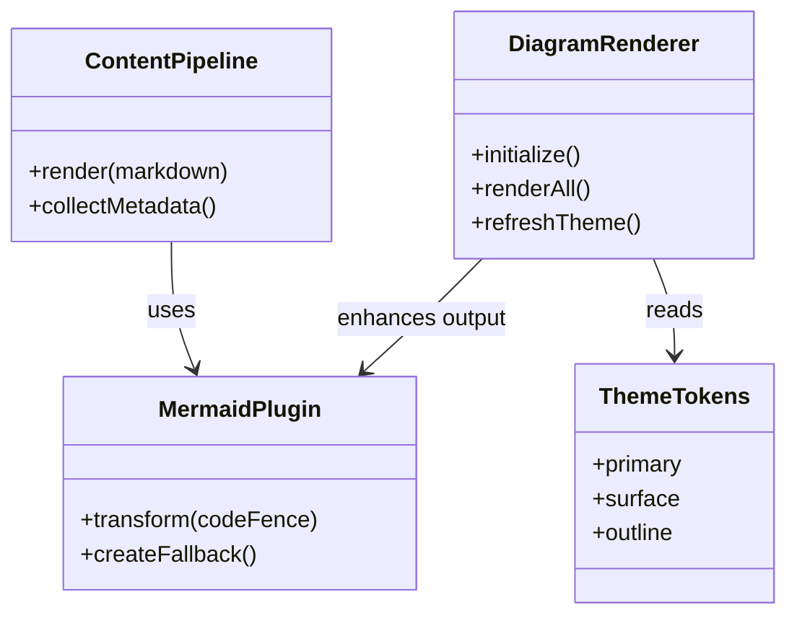

## 状态图

状态图展示对象的生命周期以及在状态之间移动它的事件。

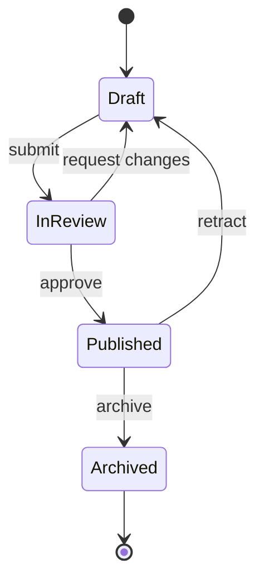

## XY 图表

XY 图表结合条形和折线，在共享轴上比较数值和趋势。

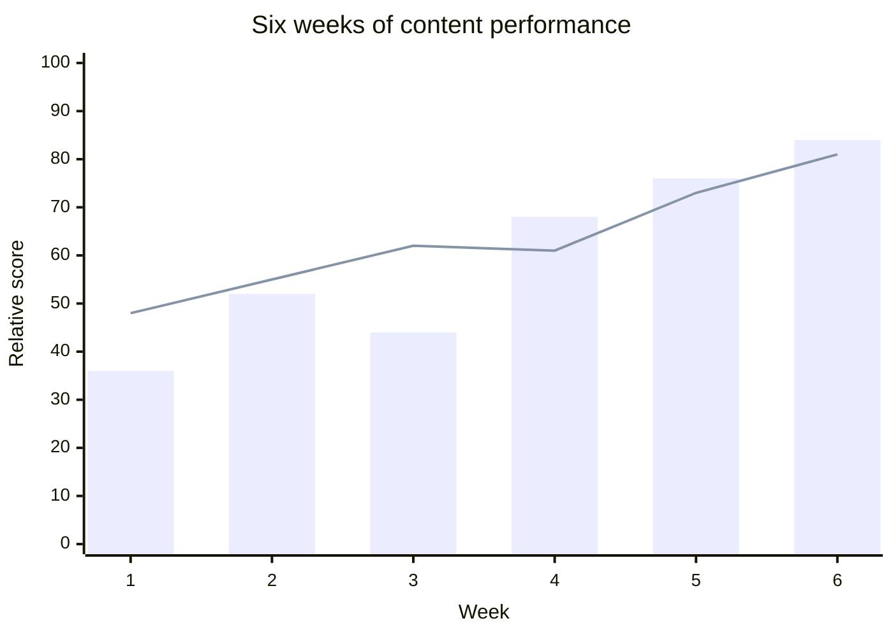

## 饼图

饼图以紧凑的方式比较各类别对整体的贡献。

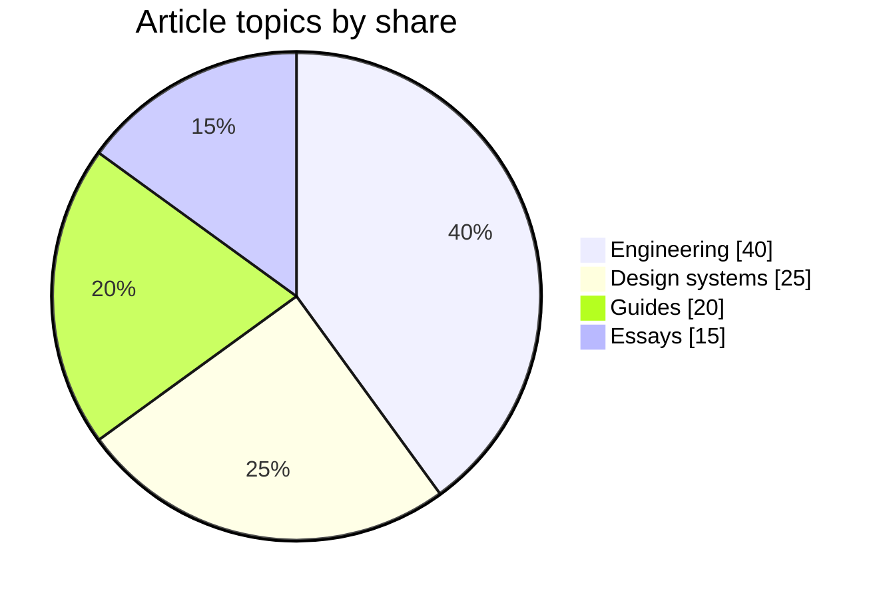

## 甘特图

甘特图沿日历时间线排列任务、依赖关系和里程碑。

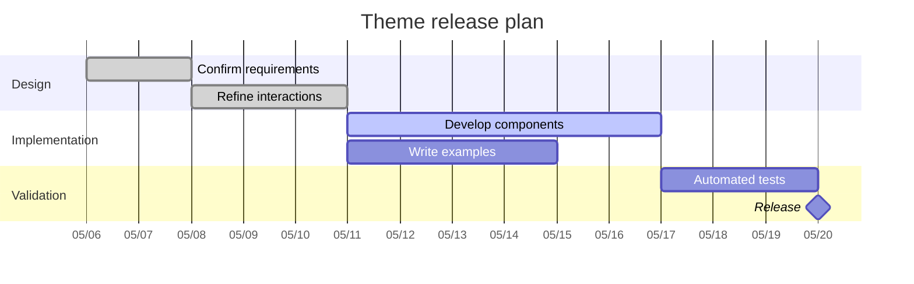

## 思维导图

思维导图将中心主题扩展为相关领域和支持性概念。

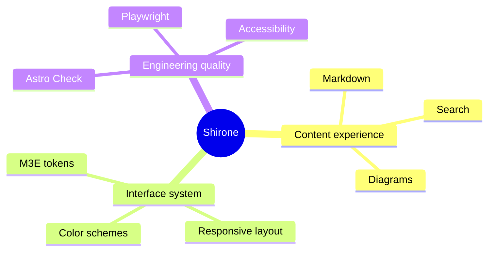

## 时间线

时间线总结重要事件或阶段，而不需要精确的日历时长。

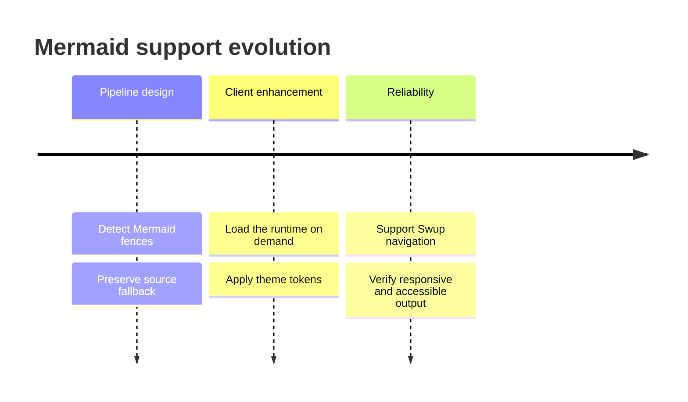

## 用户旅程图

用户旅程图结合任务各阶段中的操作、参与者和体验评分。

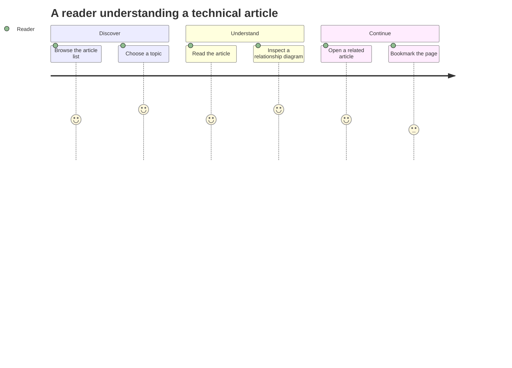

## Git 图

Git 图展示在功能分支合并到主线之前，工作是如何推进的。

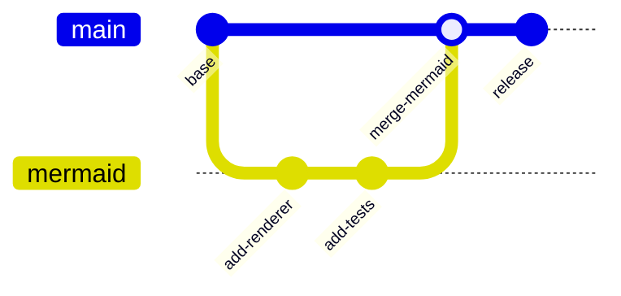

## 看板

看板按工作流状态对任务进行分组，使当前进度一目了然。

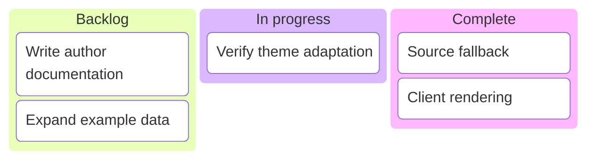

## 桑基图

桑基图使用连线宽度展示流量或其他数量在节点之间的流动。

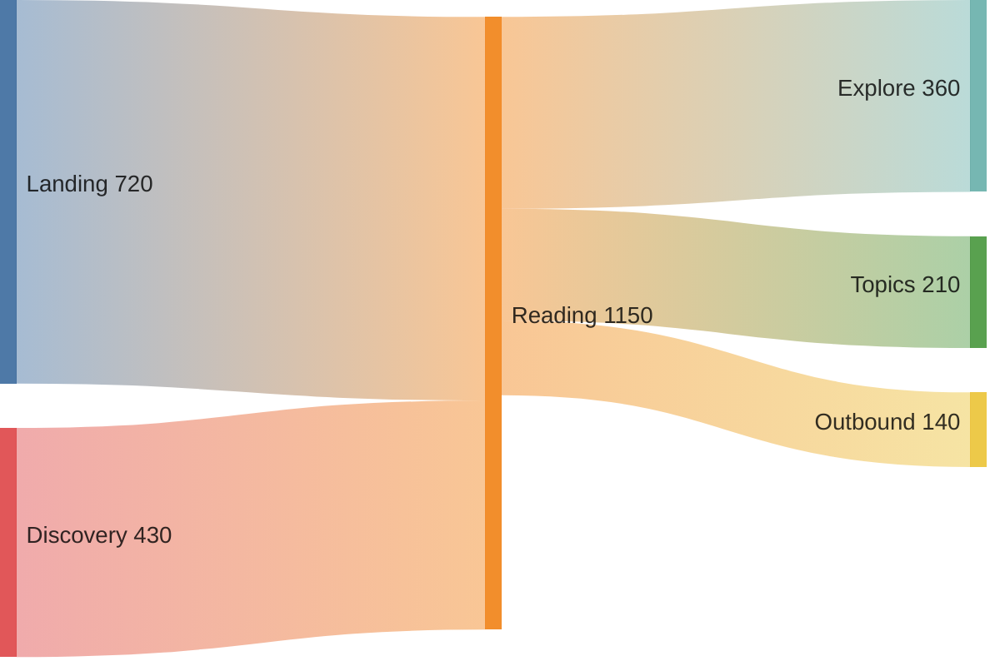

每个示例都使用标准的 `mermaid` 围栏代码块。服务器保留可读的源标记，浏览器将其增强为跟随当前主题的 SVG。当主题更改或 Swup 导航到本文时，图表会重新渲染。
