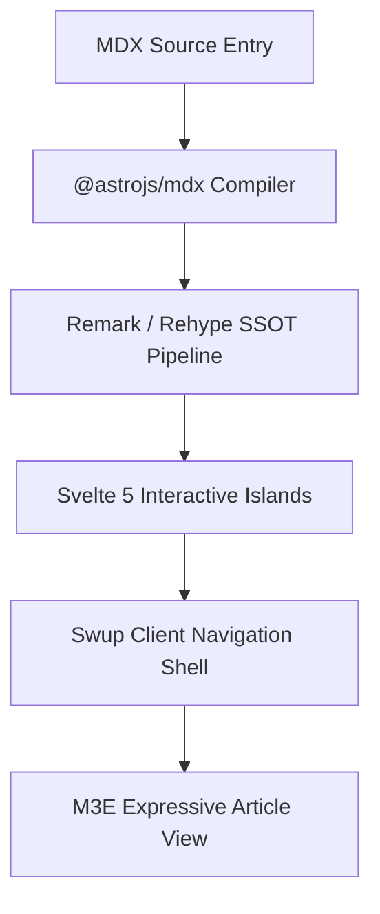

import Button from "@components/atoms/action/Button.svelte";
import Chips from "@components/atoms/action/Chips.svelte";
import Card from "@components/atoms/display/Card.svelte";
import AccentBar from "@components/atoms/display/AccentBar.svelte";
import Badge from "@components/atoms/display/Badge.svelte";
import Divider from "@components/atoms/display/Divider.svelte";
import Skeleton from "@components/atoms/display/Skeleton.svelte";
import LoadingIndicator from "@components/atoms/feedback/LoadingIndicator.svelte";
import ProgressIndicator from "@components/atoms/feedback/ProgressIndicator.svelte";
import TextField from "@components/atoms/input/TextField.svelte";
import Switch from "@components/atoms/selection/Switch.svelte";
import Checkbox from "@components/atoms/selection/Checkbox.svelte";
import SegmentedButton from "@components/atoms/selection/SegmentedButton.svelte";
import Slider from "@components/atoms/selection/Slider.svelte";

export const authorInfo = {
  framework: "Astro 7",
  ui: "Svelte 5",
  tokens: "M3E Design Tokens",
  architecture: "Islands Architecture"
};

export const showcaseItems = [
  { name: "Atomic Component Embedding", desc: "Directly import and render 60+ M3E atoms and molecules in article content" },
  { name: "Svelte 5 Islands", desc: "Selective hydration via client:visible ensures zero unnecessary JavaScript overhead" },
  { name: "JSX Expressions", desc: "Native JavaScript variables, data mappings, and conditional rendering" },
  { name: "Extension Pipeline", desc: "Unified SSOT compilation for Mermaid, KaTeX, Admonitions, and Expressive Code" }
];

export const filterChipOptions = [
  { value: "all", label: "All Components" },
  { value: "display", label: "Display Atoms" },
  { value: "feedback", label: "Feedback" },
  { value: "action", label: "Interactive" }
];

export const segmentedOptions = [
  { value: "linear", label: "Linear" },
  { value: "circular", label: "Circular" },
  { value: "morph", label: "Morphing" }
];

:::tip
**MDX（Markdown + JSX）** 弥合了静态写作与应用界面之间的鸿沟。在 Shirone 中，作者可以直接在文章内容中无缝混合动态逻辑、响应式 Svelte 5 组件和 Material 3 设计令牌。
:::

## 1. Markdown 与 MDX 能力对比矩阵

| 功能 | 标准 Markdown（`.md`） | Shirone MDX（`.mdx`） | 执行模式 |
| :--- | :--- | :--- | :--- |
| **排版与结构** | 完全支持 | 完全支持 | 静态 SSR |
| **代码高亮** | 行号、框架、可折叠 | 行号、框架、可折叠 | 静态 SSR（Expressive Code） |
| **图表与数学** | Mermaid、KaTeX | Mermaid、KaTeX | 客户端增强 |
| **提示块** | Note、Tip、Important、Warning、Caution | Note、Tip、Important、Warning、Caution | 静态 SSR |
| **M3E 展示原子** | 不可用 | 直接集成（`<Card>`、`<Skeleton>`） | 纯 SSR（零客户端 JS） |
| **Svelte 5 响应式岛屿** | 不可用 | 按需水合（`<Button>`、`<Switch>`） | `client:visible` 懒加载水合 |
| **反馈与加载原子** | 不可用 | 动画变形（`<LoadingIndicator>`） | `client:visible` 响应式 |
| **动态 JSX 表达式** | 不可用 | 原生求值（`{authorInfo.ui}`） | 编译时 / 客户端 |

---

## 2. 动态表达式与数据映射

MDX 允许在文件顶部使用 `export const` 声明作用域常量，这些常量可以在行内求值或跨模板映射：

- **核心框架**：{authorInfo.framework}
- **UI 引擎**：{authorInfo.ui}
- **设计令牌**：{authorInfo.tokens}
- **架构模式**：{authorInfo.architecture}

数组和集合可以动态渲染为网格布局：

  {showcaseItems.map((item, idx) => (
    

      

        
          {idx + 1}
        
        {item.name}
      

      
{item.desc}

    

  ))}

---

## 3. M3E 展示与布局原语（仅 SSR）

根据 Shirone 的组件架构（`docs/atomic-structure.md`），无状态的展示组件输出干净、无障碍的语义化 HTML，且没有客户端运行时负载。

### 3.1 卡片容器（`Card.svelte`）

  <Card variant="filled" class="!p-5">
    
Filled Card

    
Default container background with no elevation shadow. Ideal for grouped content blocks.

  </Card>

  <Card variant="elevated" class="!p-5">
    
Elevated Card

    
Level 1 container elevation with interactive state layering for heightened visual focus.

  </Card>

  <Card variant="outlined" class="!p-5">
    
Outlined Card

    
A crisp 1px outline boundary providing clean separation on neutral surfaces.

  </Card>

### 3.2 强调条与徽章（`AccentBar` 与 `Badge`）

  <AccentBar size="large" />
  

    System Announcement
    
Combine AccentBar with Badge to build prominent visual callouts

  

  <Badge>M3E v0.192</Badge>

### 3.3 骨架占位符（`Skeleton.svelte`）

用于预览布局骨架或制作异步状态原型：

  

    <Skeleton variant="circle" width="2.5rem" height="2.5rem" />
    

      <Skeleton variant="text" width="40%" height="0.875rem" />
      <Skeleton variant="text" width="25%" height="0.75rem" />
    

  

  <Skeleton variant="rect" width="100%" height="3rem" radius="0.5rem" />

---

## 4. 反馈与加载指示器

Shirone 具备完整保真度的 Material 3 Expressive 动效与反馈原子：

### 4.1 变形加载指示器（`LoadingIndicator.svelte`）

使用 `androidx.graphics.shapes` 多边形变形实现，提供平滑的弹簧插值 7 形状动画：

  

    

      <LoadingIndicator client:visible />
    

    Indeterminate Shape Morph
  

  

    

      <LoadingIndicator client:visible contained />
    

    Contained Circular Variant
  

  

    

      <LoadingIndicator client:visible progress={0.68} />
    

    Determinate Progress (68%)
  

### 4.2 线性与不确定进度（`ProgressIndicator.svelte`）

  

    

      Pipeline Compilation
      80%
    

    <ProgressIndicator client:visible progress={0.8} />
  

  

    
Continuous Dual-Line Animation

    <ProgressIndicator client:visible />
  

---

## 5. 交互式 Svelte 5 岛屿

使用 `client:visible` 声明的组件会在进入视口时通过 `IntersectionObserver` 进行懒加载水合：

### 5.1 按钮矩阵（`Button.svelte`）

  <Button client:visible variant="filled">Filled Button</Button>
  <Button client:visible variant="elevated">Elevated</Button>
  <Button client:visible variant="tonal">Tonal Button</Button>
  <Button client:visible variant="outlined">Outlined</Button>
  <Button client:visible variant="text">Text Button</Button>

### 5.2 筛选标签与分段按钮（`Chips` 与 `SegmentedButton`）

  

    
M3E Filter Chips

    <Chips client:visible items={filterChipOptions} value="all" />
  

  <Divider />

  

    
Segmented Control

    <SegmentedButton client:visible options={segmentedOptions} value="linear" />
  

### 5.3 开关、复选框与滑块（`Switch`、`Checkbox`、`Slider`）

  

    Switch with Status Icons
    <Switch client:visible checked={true} icons label="Push notifications" />
  

  <Divider />

  

    Selection Checkboxes
    

      <Checkbox client:visible checked={true} label="Selected" />
      <Checkbox client:visible checked={false} label="Unselected" />
      <Checkbox client:visible checked={null} triState label="Indeterminate" />
    

  

  <Divider />

  

    Hue Spectrum Slider
    <Slider client:visible value={60} label="Hue adjustment" />
  

### 5.4 输入控件（`TextField.svelte`）

  <TextField client:visible variant="filled" label="Filled Text Field" placeholder="Enter text..." />
  <TextField client:visible variant="outlined" label="Outlined Text Field" placeholder="Enter text..." />

---

## 6. Markdown 扩展兼容性

Shirone 的 SSOT 统一插件管道保持与所有 Markdown 扩展的完全兼容：

### 6.1 GitHub 仓库卡片

::github{repo="saicaca/fuwari"}

### 6.2 Mermaid 架构图

### 6.3 数学表达式（LaTeX / KaTeX）

行内公式：质能等价 $E = mc^2$ 和高斯积分 $\int_{-\infty}^{\infty} e^{-x^2} dx = \sqrt{\pi}$。

块级公式：

$$
\mathcal{L}_{M3E} = \sum_{i=1}^{N} \left( \text{Token}_i \cdot \text{ContrastRatio} \right) + \lambda \|\text{MotionElegance}\|
$$

---

## 7. 总结

MDX 的原生集成使技术作者能够构建丰富的交互式文档，同时保持 Shirone 超快的静态性能。所有组件都遵循 Material 3 Expressive 令牌设计系统，确保一致性、无障碍性和视觉和谐。
